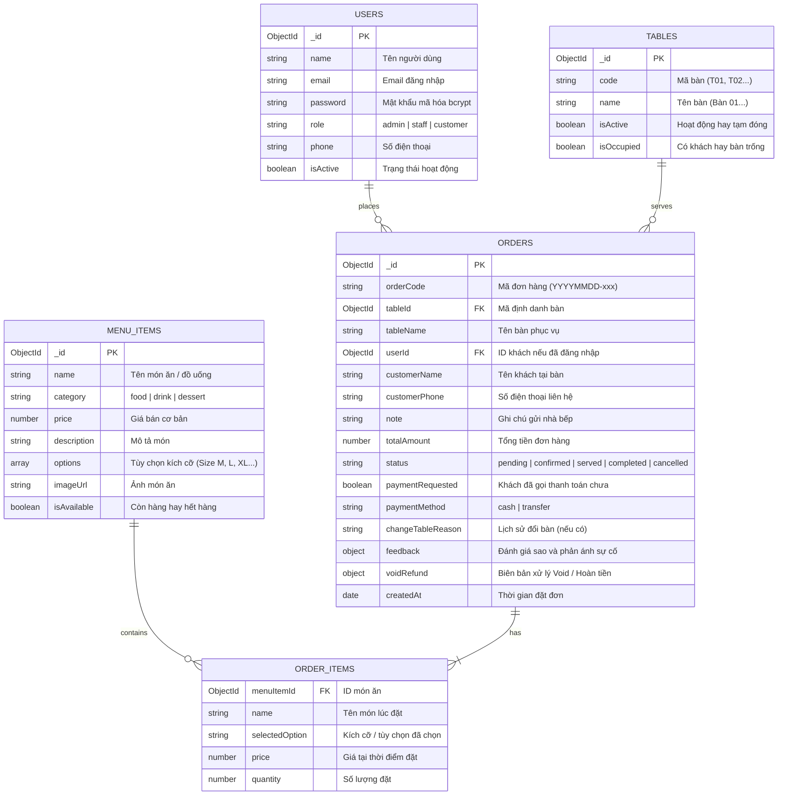

# ĐỒ ÁN MÔN HỌC MMA301: LẬP TRÌNH ỨNG DỤNG DI ĐỘNG BẰNG REACT NATIVE

## ĐỀ TÀI: ỨNG DỤNG GỌI MÓN TẠI BÀN CHO NHÀ HÀNG / QUÁN ĂN (F&B SMART TABLE ORDER APP)

---

## 1. GIỚI THIỆU ĐỀ TÀI

### 1.1. Bối Cảnh & Mục Tiêu Dự Án
Trong các nhà hàng và quán ăn hiện đại, việc khách hàng phải chờ nhân viên mang menu giấy đến bàn, ghi chép thủ công rồi chuyển vào bếp thường gây ra tình trạng chậm trễ, sai sót món ăn và khó kiểm soát trạng thái bàn.

Dự án **"Ứng dụng gọi món tại bàn cho nhà hàng / quán ăn (F&B Smart Table Order App)"** được xây dựng nhằm giải quyết triệt để bài toán trên:
- **Khách hàng tại bàn:** Sử dụng ứng dụng di động React Native để xem thực đơn trực quan, chọn kích cỡ/món thêm, gửi đơn trực tiếp vào nhà bếp, theo dõi trạng thái món ăn theo thời gian thực (Realtime), gọi nhân viên thanh toán và gửi đánh giá dịch vụ.
- **Nhà bếp & Thu ngân:** Quản lý tập trung trên màn hình điều phối đơn hàng, tiếp nhận đơn, cập nhật trạng thái món ra bàn và chốt thanh toán tự động.

---

## 2. KIẾN TRÚC HỆ THỐNG (CLIENT - SERVER)

Hệ thống được tổ chức theo mô hình Monorepo 3 tầng độc lập:

```text
F-B-Order-Management-System-MMA301-AppMoblie-ReactNative/
├── mobile-app/     Ứng dụng di động dành cho Khách hàng tại bàn (React Native / Expo)
├── admin-web/      Web Admin dành cho Quản lý / Bếp / Thu ngân (React Vite + Bootstrap)
└── backend/        Máy chủ xử lý logic và cơ sở dữ liệu (Node.js + Express + MongoDB + Socket.IO)
```

---

## 3. THIẾT KẾ CƠ SỞ DỮ LIỆU (MONGODB DATABASE SCHEMA)

Hệ thống sử dụng **MongoDB (NoSQL)** thông qua Mongoose ORM, đảm bảo tính mở rộng cao và đáp ứng đúng quy định không dùng SQLite.



---

## 4. DANH SÁCH CÁC MÀN HÌNH CHÍNH (REACT NATIVE MOBILE APP)

Ứng dụng di động bao gồm 5 màn hình chính kết nối liền mạch qua hệ thống Navigation:

1. **Màn hình Đăng Nhập & Chọn Bàn (`LoginScreen`):**
   - Lựa chọn bàn ngồi phục vụ (Bàn 01, Bàn 02, Bàn 03...).
   - Nhập thông tin khách hàng (Tên, số điện thoại - tùy chọn).
   - Nút xác nhận chuyển thẳng vào thực đơn.
2. **Màn hình Thực Đơn Gọi Món (`MenuScreen`):**
   - Danh sách món ăn trực quan theo từng phân loại (Tất cả, Món ăn, Đồ uống, Tráng miệng).
   - Thanh tìm kiếm món ăn nhanh.
   - Hộp thoại chọn kích cỡ / tùy chọn (Size M, Size L, Size XL hoặc Thường, Đặc biệt) kèm giá phụ thu tương ứng.
   - Thanh Floating Bar hiển thị số lượng món và tổng tiền tạm tính.
3. **Màn hình Giỏ Hàng (`CartScreen`):**
   - Xem lại danh sách các món đã chọn kèm tùy chọn kích cỡ.
   - Tăng, giảm số lượng hoặc xóa món khỏi giỏ hàng.
   - Nhập ghi chú riêng cho đầu bếp (ví dụ: Ít cay, không hành, nhiều đá...).
   - Nút "Xác Nhận Gửi Đơn" gọi trực tiếp API `POST /api/orders` tới Server.
4. **Màn hình Theo Dõi Đơn Hàng Realtime (`OrderTrackingScreen`):**
   - Thanh tiến độ phục vụ 4 bước: `1. Đã gửi` -> `2. Đang làm` -> `3. Đã lên món` -> `4. Hoàn tất`.
   - Kết nối Socket.IO: Tự động cập nhật tức thời khi Bếp hoặc Thu ngân thao tác trên Web Admin.
   - Tính năng Hủy đơn hàng (khi đơn còn ở trạng thái chờ quán xác nhận).
   - Nút "Gọi Thanh Toán Tại Bàn" thông báo cho thu ngân.
   - Nút "Đánh Giá / Khiếu Nại" mở Modal chấm điểm từ 1 đến 5 sao và phân loại sự cố (Lỗi nhân viên hoặc Lỗi món ăn).
5. **Màn hình Lịch Sử Đơn Hàng (`OrderHistoryScreen`):**
   - Danh sách các đơn hàng đã gọi trong ngày của bàn/thiết bị.
   - Hiển thị chi tiết trạng thái đơn, tổng tiền thanh toán và thời gian gọi món.

---

## 5. CÔNG NGHỆ BẮT BUỘC SỬ DỤNG

- **Mobile App:** React Native, Expo, React Navigation (Native Stack + Bottom Tabs), Axios, Socket.IO Client.
- **Backend:** Node.js, Express.js, Mongoose (MongoDB Driver), JWT (JSON Web Token), Socket.IO Server.
- **Database:** MongoDB Atlas / Local MongoDB Server.
- **Web Admin:** React 18, Vite, React-Bootstrap.

---

## 6. HƯỚNG DẪN CÀI ĐẶT VÀ CHẠY ỨNG DỤNG

### 6.1. Khởi Chạy Backend (Cổng 5000)
```powershell
cd backend
npm install
node seed.js    # Khởi tạo dữ liệu mẫu ban đầu (Món ăn, Bàn, Tài khoản)
npm run dev     # Khởi chạy server tại http://localhost:5000
```

### 6.2. Khởi Chạy Web Admin (Cổng 5173)
```powershell
cd admin-web
npm install
npm run dev     # Mở trình duyệt tại http://localhost:5173
```
Tài khoản đăng nhập quản trị mẫu:
- Quản trị viên (Admin): `admin@example.com` / Mật khẩu: `admin123`
- Nhân viên (Staff): `staff@example.com` / Mật khẩu: `staff123`

### 6.3. Khởi Chạy Mobile App React Native
```powershell
cd mobile-app
npm install
npm start       # Khởi chạy Expo Dev Server
```
- **Chạy trên điện thoại thật:** Tải app **Expo Go** trên Google Play / App Store, sau đó quét mã QR trên màn hình terminal.
- **Chạy trên máy ảo Android Studio:** Nhấn phím `a` trên bàn phím terminal để mở ứng dụng trên máy ảo Android.

---

## 7. BÁO CÁO TIẾN ĐỘ THEO YÊU CẦU MÔN HỌC

- **Giai đoạn 1 (Slot 1):** Đã hoàn thành phân tích đề tài, thiết kế sơ đồ cơ sở dữ liệu MongoDB, khởi tạo cấu trúc repository trên GitHub, thiết lập navigation và khung 5 màn hình chính của React Native.
- **Giai đoạn 2 (Slot 2):** Đã hoàn thành hệ thống Backend RESTful API CRUD và Web Admin quản lý tập trung.
- **Giai đoạn 3 (Slot 3):** Hoàn thiện kết nối API giữa Mobile App với Backend, kiểm thử trên thiết bị thật và máy ảo Android.
